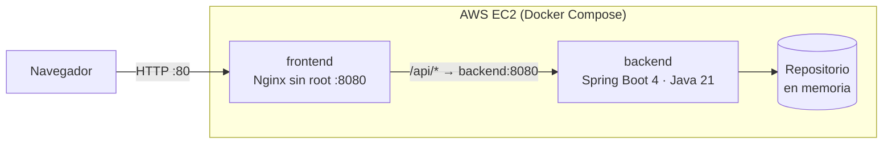
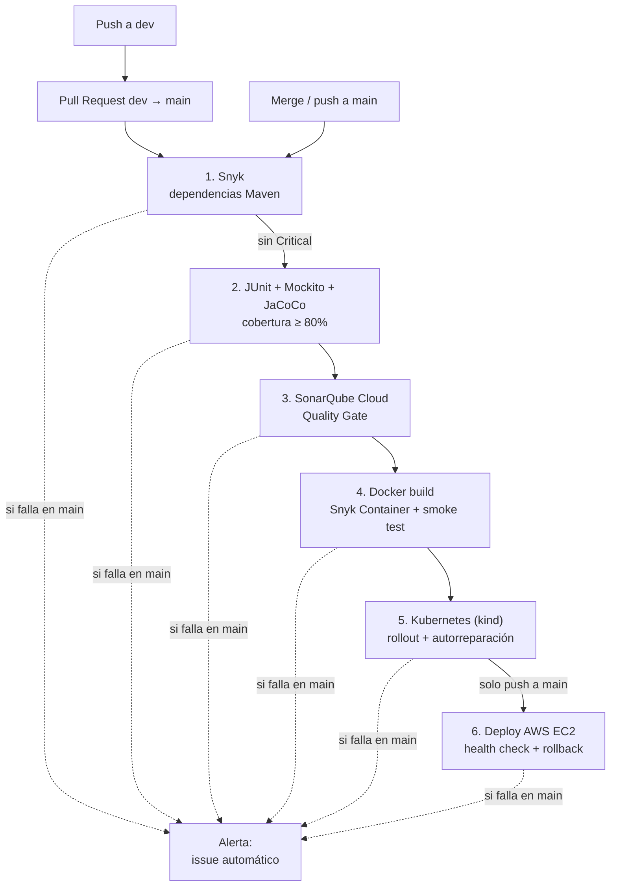

# MiniBiblioteca DevSecOps · CI/CD en AWS EC2 Free Tier

Evaluación Parcial N°2 — **Ingeniería DevOps (DOY0101)** · Duoc UC
Encargo: *"Añadiéndole complejidad a nuestro pipeline"*

| Integrante | Rol / aporte |
|---|---|
| Fernando Villalobos | _(completar)_ |
| _(compañero/a)_ | _(completar)_ |

Microservicio Spring Boot + frontend Nginx, contenerizados con Docker, orquestados con Docker Compose (EC2) y Kubernetes (validado en CI), con un pipeline CI/CD en GitHub Actions que integra pruebas automatizadas, análisis de seguridad, Quality Gate, despliegue automático con rollback y trazabilidad de punta a punta.

---

## Índice

1. [Arquitectura](#1-arquitectura)
2. [Pipeline CI/CD](#2-pipeline-cicd)
3. [Contenedores (IE1)](#3-contenedores-ie1)
4. [Pruebas y política de calidad (IE2)](#4-pruebas-y-política-de-calidad-ie2)
5. [Seguridad y escalabilidad (IE3)](#5-seguridad-y-escalabilidad-ie3)
6. [Despliegue automático y trazabilidad (IE4)](#6-despliegue-automático-y-trazabilidad-ie4)
7. [Orquestación (IE5)](#7-orquestación-ie5)
8. [Configuración del repositorio](#8-configuración-del-repositorio)
9. [Ejecución local](#9-ejecución-local)
10. [Preparación y operación de la EC2](#10-preparación-y-operación-de-la-ec2)
11. [Qué pasa si algo falla](#11-qué-pasa-si-algo-falla)
12. [Estructura del proyecto](#12-estructura-del-proyecto)
13. [Declaración de uso de IA](#13-declaración-de-uso-de-ia)
14. [Conclusiones y reflexiones](#14-conclusiones-y-reflexiones)

---

## 1. Arquitectura



| Componente | Tecnología | Límites en EC2 |
|---|---|---|
| frontend | Nginx (`nginx-unprivileged:alpine`) sirve HTML/CSS/JS y hace proxy de `/api` | 96 MiB · 0,20 CPU |
| backend | Spring Boot 4.1.2 · Java 21 (`eclipse-temurin:21-jre-alpine`) | 480 MiB · 0,60 CPU |
| persistencia | Repositorio en memoria (Controller → Service → Repository) | 0 MiB (sin contenedor de BD) |

- Solo el **puerto 80** se publica a Internet. El backend (`8080`) existe únicamente en la red interna de Compose.
- La EC2 **no compila ni construye imágenes**: todo el trabajo pesado ocurre en GitHub Actions y la instancia solo recibe imágenes listas. Esto hace viable el proyecto en una instancia de 1 GiB de RAM.

---

## 2. Pipeline CI/CD

Archivo: [`.github/workflows/ci-cd.yml`](.github/workflows/ci-cd.yml)



| # | Job | Depende de | Qué hace | Bloquea si… |
|---|---|---|---|---|
| 1 | `seguridad_snyk` | — | Análisis SCA de dependencias Maven con Snyk. Publica `snyk-report.json`. | Hay una vulnerabilidad **Critical** |
| 2 | `pruebas` | 1 | `mvn clean verify`: JUnit 5 + Mockito, reporte JaCoCo y verificación de cobertura mínima. | Falla una prueba o la cobertura baja del 80 % de líneas |
| 3 | `sonarcloud` | 2 | Análisis estático, importa la cobertura JaCoCo y **espera el Quality Gate** (`sonar.qualitygate.wait=true`). | Quality Gate = FAILED |
| 4 | `docker` | 3 | Construye ambas imágenes etiquetadas con el SHA, las escanea con **Snyk Container**, levanta el stack y ejecuta un smoke test. En `main` publica las imágenes en GHCR. | Imagen con vulnerabilidad Critical o el smoke test falla |
| 5 | `kubernetes` | 4 | Crea un clúster **kind**, despliega `k8s/` con las mismas imágenes, prueba la app y la autorreparación. | Rollout, probes o prueba fallan |
| 6 | `deploy` | 4, 5 | Solo en **push a `main`**: copia imágenes a la EC2, levanta Compose, verifica y hace **rollback automático** si falla. | Health check falla (tras intentar rollback) |
| — | `alerta` | todos | Si algo falla en `main`, abre un **issue** con el resultado de cada etapa y el enlace al run. | — |

**Flujo de ramas:** se trabaja en `dev` → Pull Request a `main` (se ejecutan los jobs 1–5; el deploy queda *Skipped*) → merge → push a `main` ejecuta todo nuevamente y despliega.

**Concurrencia:** un grupo por rama. Los PR cancelan ejecuciones antiguas de sí mismos; en `main` las ejecuciones se encolan para no cortar un despliegue a medias.

---

## 3. Contenedores (IE1)

| Imagen | Decisiones |
|---|---|
| [`backend/Dockerfile`](backend/Dockerfile) | **Multi-stage**: Maven solo en la etapa de build; la imagen final usa únicamente el JRE Alpine. Usuario sin privilegios `app`. `HEALTHCHECK` sobre `/api/health`. Heap acotado (`MaxRAMPercentage` / `-Xmx256m`). |
| [`frontend/Dockerfile`](frontend/Dockerfile) | `nginx-unprivileged:alpine` (uid 101, sin root). `HEALTHCHECK` sobre `/healthz`. Cabeceras de seguridad y `server_tokens off` en [`nginx.conf`](frontend/nginx.conf). |

Ambas imágenes llevan **etiquetas OCI** (`org.opencontainers.image.revision`, `version`, `source`) con el SHA del commit, por lo que cualquier contenedor en ejecución puede rastrearse hasta su código fuente:

```bash
docker inspect minibiblioteca-backend:<sha> --format '{{index .Config.Labels "org.opencontainers.image.revision"}}'
```

---

## 4. Pruebas y política de calidad (IE2)

| Suite | Tipo | Qué cubre |
|---|---|---|
| `LibroServiceTest` | Unitaria (Mockito) | Lógica del servicio con repositorio simulado: listar, buscar, excepción 404, contar disponibles |
| `LibroControllerTest` | Unitaria HTTP (MockMvc standalone) | Rutas, códigos 200/404, JSON de respuesta y `/api/health` |
| `LibroRepositoryMemoriaTest` | Unitaria | Catálogo inicial y búsquedas del repositorio real |
| `MiniBibliotecaApplicationTest` | Integración (`@SpringBootTest`) | El contexto de Spring arranca y conecta todas las capas |
| Smoke test (job 4) | Sistema | Stack completo en Docker: health, catálogo, página web y 404 |
| Prueba en kind (job 5) | Sistema | Misma app en Kubernetes + autorreparación de pods |

**Políticas de calidad aplicadas automáticamente:**

1. Todas las pruebas deben pasar (`mvn verify`).
2. **Cobertura mínima JaCoCo**: 80 % de líneas y 70 % de ramas (regla `jacoco:check` en [`pom.xml`](backend/pom.xml)). Si baja, el build falla.
3. **Quality Gate de SonarQube Cloud** (bugs, vulnerabilidades, code smells, duplicación y cobertura del código nuevo).

Cada ejecución publica en el resumen del job una tabla con las pruebas por suite y el porcentaje de cobertura, además de los artifacts `jacoco-backend` y `junit-backend`.

---

## 5. Seguridad y escalabilidad (IE3)

### Seguridad en el pipeline

| Control | Herramienta | Umbral / bloqueo |
|---|---|---|
| Dependencias Maven (SCA) | Snyk (`snyk test`) | Bloquea con Critical; reporte siempre publicado como artifact |
| Imágenes Docker (SO base) | Snyk Container | Bloquea con Critical |
| Código fuente (SAST) | SonarQube Cloud | Bloquea si el Quality Gate falla |
| Actualización de dependencias | Dependabot ([`dependabot.yml`](.github/dependabot.yml)) | PR semanales (Maven, Actions, Docker); cada PR pasa por el pipeline completo |
| Secretos | GitHub Secrets | Nunca en el código; el pipeline valida que existan antes de usarlos |
| Alertas | Job `alerta` | Issue automático cuando falla `main` |
| Rama protegida | Branch protection en `main` | No se puede fusionar un PR con checks en rojo (ver §8) |

Dependabot ignora saltos mayores de las imágenes Java para no cambiar la versión LTS (Java 21) sin una decisión explícita del equipo.

### Seguridad en tiempo de ejecución (Compose y Kubernetes)

- Contenedores **sin root**, `no-new-privileges`, **todas las capabilities eliminadas** (`cap_drop: ALL`).
- Sistema de archivos **de solo lectura**; solo `/tmp` es escribible (tmpfs / emptyDir).
- `pids_limit`, límites de memoria y CPU por servicio, logs rotados (10 MB × 3).
- Backend no expuesto a Internet; cabeceras `X-Content-Type-Options`, `X-Frame-Options`, `Referrer-Policy`.
- En Kubernetes: namespace con **Pod Security Admission `restricted`**, `seccompProfile: RuntimeDefault`, sin token de ServiceAccount montado.
- Frontend sin `innerHTML` con datos de la API (previene XSS).

### Parámetros de escalabilidad y desempeño

| Parámetro | Dónde | Valor |
|---|---|---|
| Réplicas del backend | `BACKEND_REPLICAS` en Compose | 1 en EC2 (1 GiB RAM), escalable: `BACKEND_REPLICAS=2` |
| Réplicas | Kubernetes `Deployment` | 2 backend + 2 frontend |
| Autoescalado | `HorizontalPodAutoscaler` | 2 a 5 pods del backend al 70 % de CPU |
| Disponibilidad | `PodDisruptionBudget` | mínimo 1 pod por servicio |
| Actualización sin caída | `RollingUpdate` | `maxSurge: 1`, `maxUnavailable: 0` |
| Memoria JVM | `JAVA_TOOL_OPTIONS` | `-Xms64m -Xmx256m`, `SerialGC` |
| Recursos | `mem_limit` / `cpus` / `requests` y `limits` | ver §1 y `k8s/` |
| Apagado ordenado | `server.shutdown=graceful` + `stop_grace_period` | 10–15 s |

---

## 6. Despliegue automático y trazabilidad (IE4)

**Entorno:** AWS EC2 (Amazon Linux, Free Tier) con Docker Compose. El deploy se realiza por SSH/SCP, sin credenciales de la API de AWS.

**Cómo se despliega** ([`deploy/deploy-remote.sh`](deploy/deploy-remote.sh)):

1. El runner descarga el paquete del job 4 (imágenes `docker save` + `docker-compose.yml` + `.env` con la versión).
2. Lo copia a la EC2 y ejecuta el script remoto, que respalda la versión actual, hace `docker load` y `docker compose up -d --no-build`.
3. Verifica `/api/health` durante 2,5 minutos.
4. **OK** → registra el despliegue y elimina imágenes antiguas (conserva la anterior para rollback).
   **Falla** → **rollback automático** a la versión anterior y el job queda en rojo.
5. El runner verifica la app **desde Internet** (`http://AWS_HOST/api/health`).

**Trazabilidad de punta a punta:**

| Eslabón | Evidencia |
|---|---|
| Código → pipeline | Cada run está asociado a un commit y a un PR/push; los PR muestran los checks |
| Pipeline → reportes | Artifacts por run: `snyk-report`, `snyk-container-report`, `jacoco-backend`, `junit-backend` y resúmenes en cada job |
| Commit → imagen | Imágenes etiquetadas con el **SHA** + etiquetas OCI `revision`; publicadas en **GHCR** (`ghcr.io/fervivi/devops-ev2/minibiblioteca-*`) |
| Imagen → producción | `.env` en la EC2 con `APP_VERSION=<sha>`; environment **`production`** de GitHub con historial de despliegues |
| Historial en el servidor | `/opt/minibiblioteca/logs/deployments.log`: fecha, resultado (OK/FALLO/ROLLBACK), versión, versión anterior, autor y URL del run |

---

## 7. Orquestación (IE5)

### Docker Compose (producción en EC2)

[`docker-compose.yml`](docker-compose.yml) define la red interna, el orden de arranque (`frontend` espera a `backend` **healthy**), healthchecks en ambos servicios, reinicio automático, límites de recursos y réplicas configurables. Es la opción adecuada para una sola instancia pequeña.

### Kubernetes (estrategia escalable, validada en CI)

[`k8s/`](k8s) contiene la misma aplicación para un clúster: `Deployment` con 2 réplicas, `startup/readiness/liveness probes`, `Service`, `HorizontalPodAutoscaler`, `PodDisruptionBudget` y Pod Security `restricted`, aplicados con Kustomize. El job 5 los despliega en un clúster **kind** efímero con las imágenes del commit, prueba la app y elimina un pod para comprobar que Kubernetes lo recrea.

```bash
kubectl apply -k k8s/
kubectl -n minibiblioteca get deploy,pods,svc,hpa
kubectl -n minibiblioteca port-forward service/frontend 8081:80
```

> En la EC2 Free Tier (1 GiB) no se instala Kubernetes porque el plano de control consumiría la mayor parte de la memoria; por eso producción usa Compose y Kubernetes queda como estrategia de escalamiento verificada en el pipeline.

---

## 8. Configuración del repositorio

**Settings → Secrets and variables → Actions**

| Tipo | Nombre | Valor |
|---|---|---|
| Secret | `SNYK_TOKEN` | Token de Snyk |
| Secret | `SONAR_TOKEN` | Token de SonarQube Cloud |
| Secret | `AWS_HOST` | IP o DNS público de la EC2 |
| Secret | `AWS_USER` | `ec2-user` |
| Secret | `AWS_SSH_KEY` | Contenido completo del `.pem` |
| Variable | `SONAR_PROJECT_KEY` | Project Key de SonarQube Cloud |
| Variable | `SONAR_ORGANIZATION` | Organization Key |
| Variable | `APP_URL` | `http://<IP_PUBLICA_EC2>` (opcional, enlace del environment) |

**SonarQube Cloud:** desactivar *Automatic Analysis* (Administration → Analysis method); el análisis lo hace el pipeline.

**Protección de `main`** (Settings → Branches → Add rule):
- Require a pull request before merging.
- Require status checks to pass: `1. Snyk - Dependencias`, `2. JUnit Mockito y JaCoCo`, `3. SonarQube Cloud`, `4. Docker Compose y Smoke Test`, `5. Kubernetes (kind)`.

Así un PR con cualquier control en rojo **no se puede fusionar**.

---

## 9. Ejecución local

Requisitos: Docker Desktop. (Maven es opcional: puede ejecutarse dentro de un contenedor.)

```bash
# Pruebas + JaCoCo (con Maven instalado)
mvn -B -f backend/pom.xml clean verify

# ...o sin Maven, usando la misma imagen del build
docker run --rm -v "$PWD/backend:/build" -w /build maven:3.10-eclipse-temurin-21-alpine mvn -B clean verify

# Levantar el stack en http://localhost:8088
APP_VERSION=local APP_PORT=8088 docker compose up -d --build
curl http://127.0.0.1:8088/api/health
curl http://127.0.0.1:8088/api/libros

# Escalar el backend a 2 réplicas
APP_VERSION=local APP_PORT=8088 BACKEND_REPLICAS=2 docker compose up -d --no-build

# Detener
APP_VERSION=local APP_PORT=8088 docker compose down
```

Reporte de cobertura: `backend/target/site/jacoco/index.html`.

---

## 10. Preparación y operación de la EC2

Security Group: **22/TCP** (SSH para GitHub Actions) y **80/TCP** (web). No abrir 8080.

```bash
# Una sola vez, dentro de la EC2: Docker, Compose v2, swap 1 GiB y /opt/minibiblioteca
bash deploy/prepare-ec2.sh
bash deploy/check-ec2.sh
```

Operación:

```bash
cd /opt/minibiblioteca/current
sudo docker compose ps
sudo docker compose logs --tail=100 backend
cat /opt/minibiblioteca/logs/deployments.log
sudo docker stats --no-stream
```

Rollback manual a la versión anterior:

```bash
cd /opt/minibiblioteca/current
cp .env.previous .env && cp docker-compose.previous.yml docker-compose.yml
sudo docker compose up -d --no-build
```

Más comandos en [`docs/COMANDOS_RAPIDOS.md`](docs/COMANDOS_RAPIDOS.md).

---

## 11. Qué pasa si algo falla

| Falla | Efecto | Qué revisar |
|---|---|---|
| Snyk Critical | Se detiene todo; `pruebas` queda *Skipped* | Artifact `snyk-report`, actualizar la dependencia |
| Snyk exit 2 | Error técnico | `SNYK_TOKEN` |
| Prueba o cobertura < 80 % | `sonarcloud` queda *Skipped* | Resumen del job, artifact `junit-backend` / `jacoco-backend` |
| Quality Gate FAILED | `docker` queda *Skipped* | Detalle del gate en SonarQube Cloud |
| Snyk Container Critical / smoke test | `kubernetes` y `deploy` *Skipped* | Artifact `snyk-container-report`, logs del job |
| Rollout en kind | `deploy` *Skipped* | Paso "Diagnóstico si falla" (events, describe, logs) |
| SSH | `deploy` falla | `AWS_HOST`, `AWS_USER`, `AWS_SSH_KEY`, puerto 22 |
| Health check en EC2 | Rollback automático + job en rojo | `deployments.log`, `docker compose logs` |
| No responde desde Internet | `deploy` falla | Puerto 80 del Security Group |

En `main`, cualquiera de estas fallas abre además un **issue automático**.

---

## 12. Estructura del proyecto

```
.
├── .github/
│   ├── workflows/ci-cd.yml      # Pipeline CI/CD completo
│   └── dependabot.yml           # Escaneo/actualización de dependencias
├── backend/                     # Spring Boot (Controller → Service → Repository)
│   ├── Dockerfile               # Multi-stage, sin root, healthcheck
│   ├── pom.xml                  # JaCoCo + cobertura mínima
│   └── src/test/...             # JUnit 5 + Mockito + MockMvc
├── frontend/                    # Nginx sin root + HTML/CSS/JS
├── k8s/                         # Deployments, Services, HPA, PDB (Kustomize)
├── deploy/
│   ├── prepare-ec2.sh           # Bootstrap de la EC2
│   ├── check-ec2.sh             # Verificación
│   └── deploy-remote.sh         # Deploy con registro y rollback
├── docker-compose.yml           # Orquestación en EC2
└── docs/COMANDOS_RAPIDOS.md
```

---

## 13. Declaración de uso de IA

De acuerdo con las indicaciones de la evaluación ([bibliotecas.duoc.cl/ia](https://bibliotecas.duoc.cl/ia)):

| Herramienta | Uso |
|---|---|
| Claude (Anthropic), mediante Claude Code | Apoyo para revisar la plantilla del proyecto contra la pauta, proponer mejoras al pipeline (Snyk Container, Kubernetes/kind, rollback, alertas), generar borradores de configuración y pruebas, y redactar la documentación técnica de este README. |

Todo el contenido generado fue revisado, ejecutado y validado por el equipo (pruebas locales con Docker y ejecuciones del pipeline en GitHub Actions). Las conclusiones y reflexiones de la sección 14 fueron redactadas **sin apoyo de IA**.

---

## 14. Conclusiones y reflexiones

> ⚠️ Esta sección debe ser redactada por el equipo **sin uso de IA**, según la pauta.

### Conclusiones del equipo

_(completar)_

### Reflexión personal — Fernando Villalobos

_(completar: aprendizaje y contribución al proyecto)_

### Reflexión personal — _(compañero/a)_

_(completar: aprendizaje y contribución al proyecto)_
